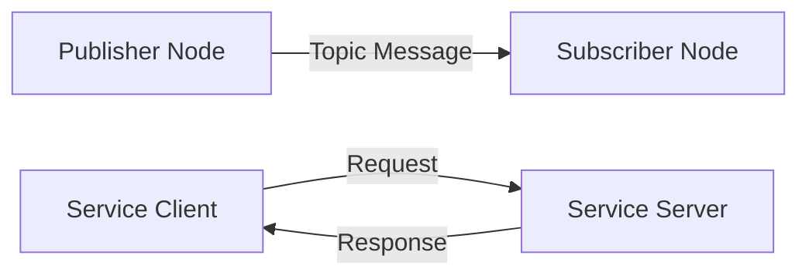
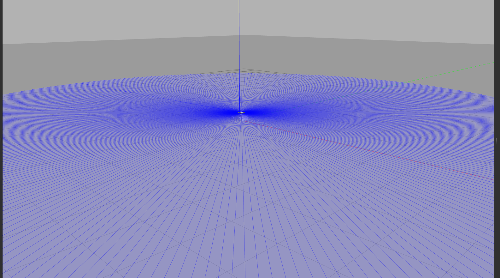

<div align="center">

# Robotics Journey

### Learning, Building and Exploring Robotics

A hands-on journey into ROS 2, robot simulation, autonomous systems and mobile robotics.

<br>


</div>

---

## About This Repository

**Robotics Journey** is my personal robotics learning and development repository, documenting my progress through practical experiments, software development and simulation-based projects.

The main objective is to build a strong foundation in robotics by understanding how different components of a robotic system work together.

This repository focuses on hands-on learning rather than theory alone, with practical implementations using **ROS 2, Python, URDF and Gazebo**.

## Table of Contents

- [Repository Overview](#repository-overview)
- [ROS 2 Basics](#1-ros-2-basics)
- [UGV Project](#2-ugv-project)
- [Technology Stack](#technology-stack)
- [Getting Started](#getting-started)
- [Learning Roadmap](#learning-roadmap)
- [Future Goals](#future-goals)
- [Author](#author)

---

## Repository Overview

| Project | Description | Status |
|---|---|---|
| [ROS 2 Basics](./ros2-basics/) | Learning ROS 2 communication concepts and Python nodes. | Completed |
| [UGV Project](./ugv-project/) | Developing and simulating a four-wheeled Unmanned Ground Vehicle. | In Progress |

---

## 1. ROS 2 Basics

This section covers the fundamental concepts of ROS 2 through Python-based implementations.

### Topics Covered

- Nodes and ROS 2 communication
- Publisher and Subscriber
- Service and Client
- Launch files
- Package structure
- Workspace management

### Publisher & Subscriber

A topic-based communication model where one node publishes messages and another node receives them.

<p align="center">
  
</p>

### Service & Client

A request-response communication model implemented using ROS 2 services.

<p align="center">
  
</p>

### Launch System

Running multiple ROS 2 nodes together using Python launch files.

<p align="center">
  
</p>

### Communication Overview

The following diagram illustrates the basic communication patterns explored in this section.



**Learning Notes:**

- [English Documentation](./ros2-basics/notes.en.md)
- [Türkçe Dokümantasyon](./ros2-basics/notes.tr.md)

---

## 2. UGV Project

The UGV project focuses on developing a simulated four-wheeled **Unmanned Ground Vehicle** using ROS 2 Foxy and Gazebo.

The project explores how robot descriptions, coordinate frames, sensor data and odometry work together in a simulated mobile robot.

### Current Features

- Four-wheeled robot model
- URDF-based robot description
- RViz2 visualization
- Gazebo simulation
- TF2 coordinate frame management
- Basic odometry implementation
- LiDAR sensor integration

### UGV Simulation

<p align="center">
  
</p>

<p align="center">
  <i>Four-wheeled UGV simulation in Gazebo.</i>
</p>

### Robot Model & Sensors

| Component | Purpose |
|---|---|
| URDF | Defines the robot's physical structure and joints. |
| TF2 | Manages coordinate frames and transformations. |
| Odometry | Estimates the robot's movement. |
| LiDAR | Provides distance measurements of the surroundings. |
| Gazebo | Provides the simulation environment. |
| RViz2 | Visualizes the robot model and sensor data. |

### TF2 & Coordinate Frames

TF2 is used to manage the relationships between the robot's coordinate frames and understand how different parts of the robot are positioned relative to each other.

<p align="center">
  
</p>

### Odometry

A basic odometry node estimates the robot's movement using velocity information.

<p align="center">
  
</p>

### LiDAR Integration

LiDAR integration is part of the ongoing work toward environmental perception and mobile robot navigation.

<p align="center">
  
</p>

**Learning Notes:**

- [English Documentation](./ugv-project/notes.en.md)
- [Türkçe Dokümantasyon](./ugv-project/notes.tr.md)

---

## Technology Stack

| Technology | Usage |
|---|---|
| ROS 2 Foxy | Robot communication and software architecture |
| Python | ROS 2 node development |
| URDF | Robot modeling |
| Gazebo | Robot simulation |
| RViz2 | Robot visualization |
| TF2 | Coordinate transformations |
| Ubuntu 20.04 | Development environment |

---

## Getting Started

### Requirements

- Ubuntu 20.04
- ROS 2 Foxy
- Python 3
- Gazebo
- RViz2

### Clone the Repository

```bash
git clone https://github.com/kadirakcn00/robotics-journey.git

cd robotics-journey
```

### Build ROS 2 Basics

```bash
source /opt/ros/foxy/setup.bash

cd ros2-basics

colcon build

source install/setup.bash
```

Run the publisher:

```bash
ros2 run py_pubsub my_talker
```

Open another terminal and run the subscriber:

```bash
source /opt/ros/foxy/setup.bash

cd robotics-journey/ros2-basics

source install/setup.bash

ros2 run py_pubsub my_listener
```

### Build the UGV Project

```bash
source /opt/ros/foxy/setup.bash

cd ugv-project

colcon build

source install/setup.bash
```

For robot visualization and simulation instructions, refer to the UGV project documentation.

---

## Learning Roadmap

This repository is continuously evolving as I explore more advanced robotics concepts.

| Module | Topic | Status |
|---|---|---|
| M1 | Robot Modeling (URDF) | Completed |
| M2 | TF2 & Odometry | In Progress |
| M3 | SLAM & Mapping | Planned |
| M4 | Navigation2 (Nav2) | Planned |
| M5 | Camera & Object Detection | Planned |

---

## Future Goals

- Improve the UGV robot model and simulation environment.
- Develop a deeper understanding of mobile robot localization.
- Explore SLAM and autonomous navigation.
- Integrate camera-based perception.
- Experiment with autonomous mobile robotics.

---

## Documentation

Each project includes English and Turkish learning notes containing explanations, commands and practical examples.

The documentation is updated alongside the development process to keep track of concepts learned and implementations completed.

---

## Author

**Abdulkadir Akcan**

Computer Engineering Student | Robotics & Autonomous Systems

- GitHub: [@kadirakcn00](https://github.com/kadirakcn00)
- LinkedIn: [kadirakcn00](https://www.linkedin.com/in/kadirakcn00/)

<div align="center">

---

**Learning by building. Improving by experimenting.**

</div>
