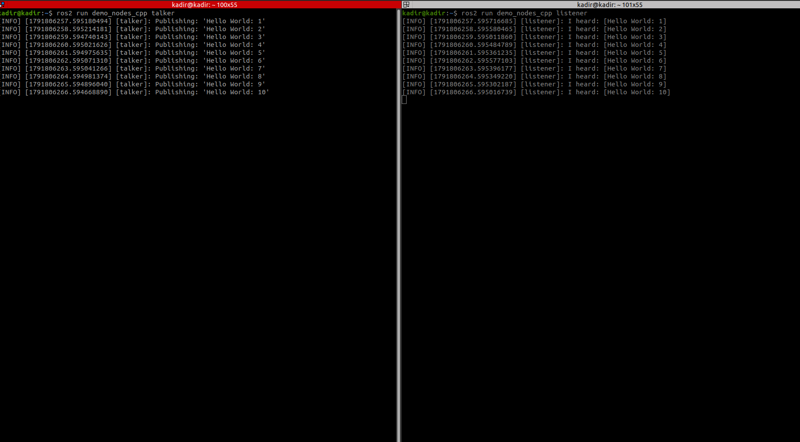
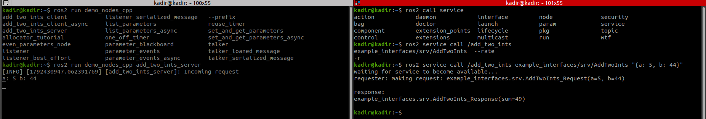
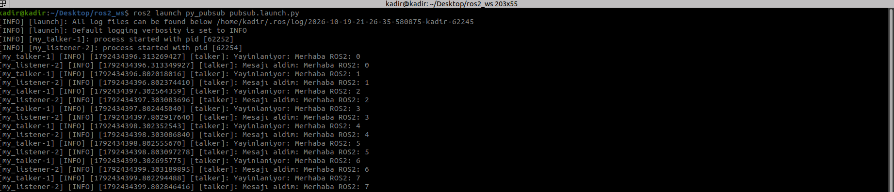
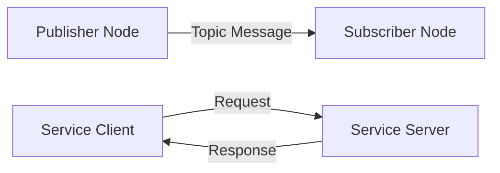
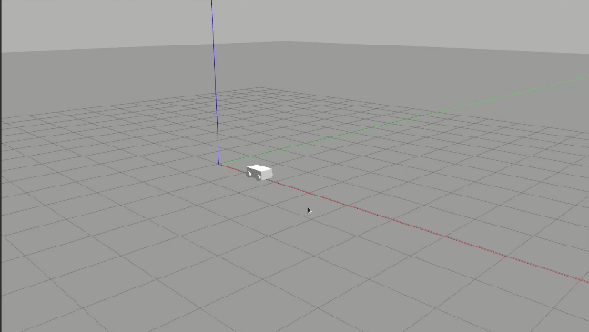
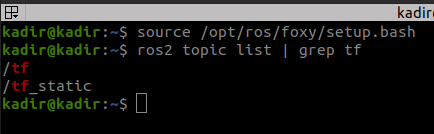
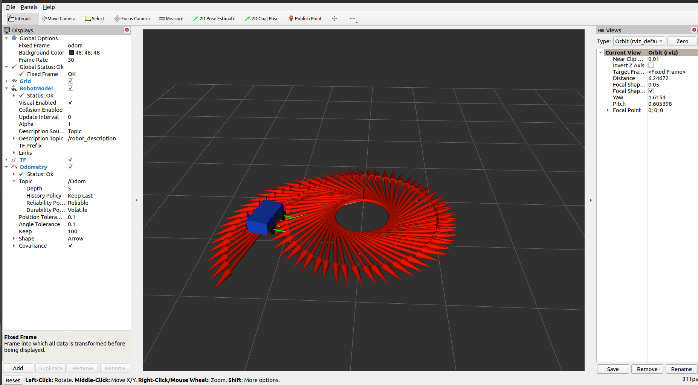
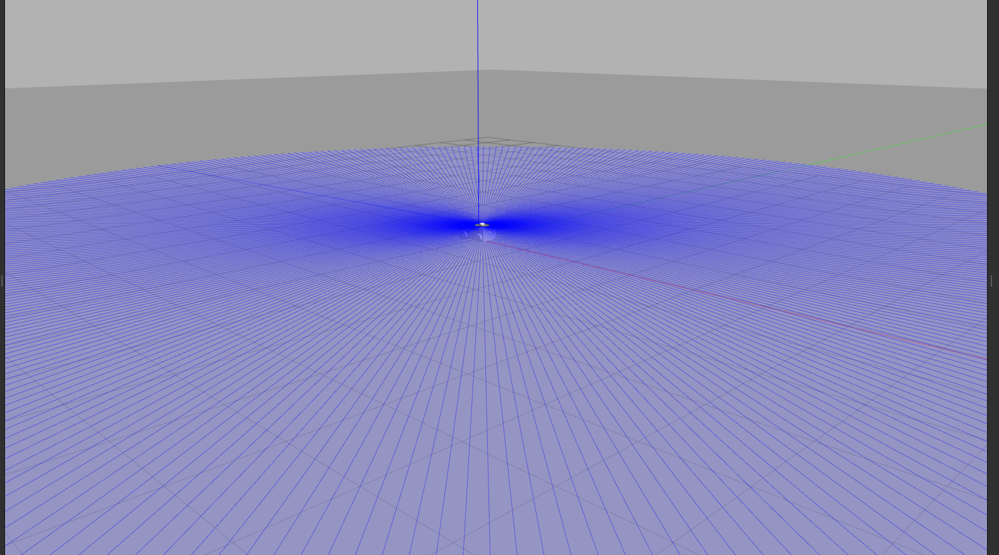
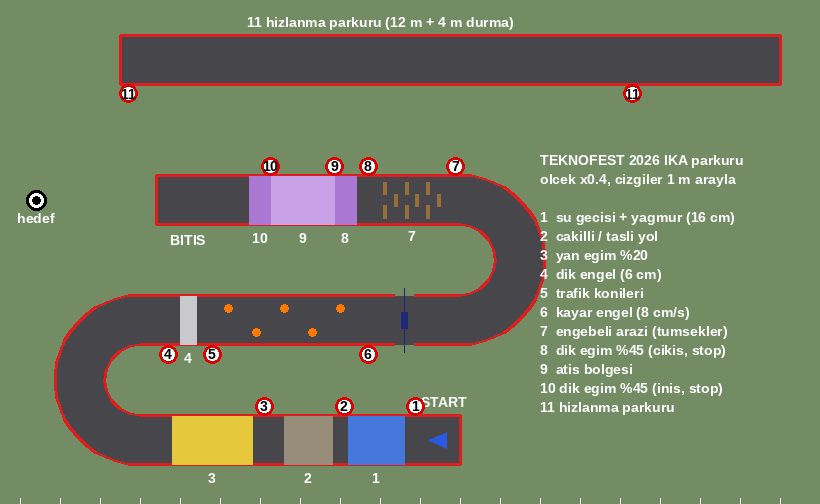
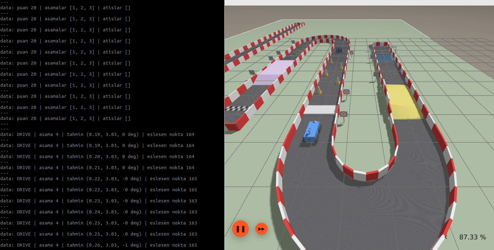

<div align="center">

# Robotics Journey

### Learning, Building and Exploring Robotics

A hands-on journey into ROS 2, robot simulation, autonomous systems and mobile robotics.

<br>


</div>

---

## About This Repository

**Robotics Journey** is my personal robotics learning and development repository, documenting my progress through practical experiments, software development and simulation-based projects.

The main objective is to build a strong foundation in robotics by understanding how different components of a robotic system work together.

This repository focuses on hands-on learning rather than theory alone, with practical implementations using **ROS 2, Python, URDF and Gazebo**.

## Table of Contents

- [Repository Overview](#repository-overview)
- [ROS 2 Basics](#1-ros-2-basics)
- [UGV Project](#2-ugv-project)
- [Technology Stack](#technology-stack)
- [Getting Started](#getting-started)
- [Learning Roadmap](#learning-roadmap)
- [Future Goals](#future-goals)
- [Author](#author)

---

## Repository Overview

| Project | Description | Status |
|---|---|---|
| [ROS 2 Basics](./ros2-basics/) | Learning ROS 2 communication concepts and Python nodes. | Completed |
| [UGV Project](./ugv-project/) | Developing and simulating a four-wheeled Unmanned Ground Vehicle. | In Progress |

---

## 1. ROS 2 Basics

This section covers the fundamental concepts of ROS 2 through Python-based implementations.

### Topics Covered

- Nodes and ROS 2 communication
- Publisher and Subscriber
- Service and Client
- Launch files
- Package structure
- Workspace management

### Publisher & Subscriber

A topic-based communication model where one node publishes messages and another node receives them.

<p align="center">
  
</p>

### Service & Client

A request-response communication model implemented using ROS 2 services.

<p align="center">
  
</p>

### Launch System

Running multiple ROS 2 nodes together using Python launch files.

<p align="center">
  
</p>

### Communication Overview

The following diagram illustrates the basic communication patterns explored in this section.



**Learning Notes:**

- [English Documentation](./ros2-basics/notes.en.md)
- [Türkçe Dokümantasyon](./ros2-basics/notes.tr.md)

---

## 2. UGV Project

The UGV project focuses on developing a simulated four-wheeled **Unmanned Ground Vehicle** using ROS 2 Humble and Gazebo Fortress (Ignition Gazebo 6), connected through `ros_gz`.

The project explores how robot descriptions, coordinate frames, sensor data and odometry work together in a simulated mobile robot.

### Current Features

- Four-wheeled robot model
- Parameterized robot description (URDF / xacro)
- RViz2 visualization
- Gazebo Fortress simulation with a custom obstacle world
- ROS 2 ↔ Gazebo topic bridge (`ros_gz_bridge`)
- TF2 coordinate frame management
- Basic odometry implementation
- LiDAR sensor integration (`gpu_lidar`)
- LiDAR-based obstacle avoidance node
- SLAM with `slam_toolbox` (online async mapping)
- Autonomous navigation with Nav2 (AMCL localization, NavFn planner, Regulated Pure Pursuit controller)
- Front, rear and aiming cameras; pan-tilt aiming turret with laser pointer
- Camera perception: TEKNOFEST stage sign reading and shooting target detection (OpenCV)
- TEKNOFEST 2026 UGV competition course in Gazebo (all 11 stages, scaled ×0.4) with custom water physics and a moving obstacle
- Driver station for the remote-controlled run: three camera views, hold-to-drive keyboard control with gears, turret and laser, emergency stop
- Course tester that drives the whole course and reports the stage where the robot gets stuck
- Referee node that scores a run by the specification's point table
- Autonomous mission: LiDAR + IMU localization, cone avoidance, sliding-obstacle timing and visual-servo shooting

### UGV Simulation

<p align="center">
  
</p>

<p align="center">
  <i>Four-wheeled UGV simulation in Gazebo.</i>
</p>

### Robot Model & Sensors

| Component | Purpose |
|---|---|
| URDF / xacro | Defines the robot's physical structure and joints; dimensions are xacro properties. |
| TF2 | Manages coordinate frames and transformations. |
| Odometry | Estimates the robot's movement. |
| LiDAR | Provides distance measurements of the surroundings (front bumper, 20 cm high, ±90°). |
| IMU | Body pitch/roll/yaw at 50 Hz; used for heading and to detect the pool and ramp slopes. |
| Cameras | Front and rear driving cameras (69° FOV) and a narrow aiming camera (14° FOV) on a pan-tilt turret. |
| Gazebo Fortress | Provides the physics simulation, diff-drive and LiDAR sensor. |
| ros_gz_bridge | Bridges `/cmd_vel`, `/odom`, `/tf`, `/scan`, `/imu`, `/joint_states` and `/clock` between ROS 2 and Gazebo. |
| RViz2 | Visualizes the robot model and sensor data. |
| slam_toolbox | Builds a 2D occupancy grid map from LiDAR scans and odometry. |
| Nav2 | Localizes the robot on the map (AMCL), plans a path and drives it to a goal. |
| ugv_perception | Reads stage sign numbers and finds the shooting target in camera images. |

### Package Structure

```
ugv-project/src/
├── ugv_description/   # Robot model (xacro) + RViz display launch
├── ugv_gazebo/        # Gazebo Fortress worlds, course models + simulation launch
├── ugv_bringup/       # Top-level launch files: sim, slam, nav, perception, course
├── ugv_slam/          # slam_toolbox parameters + saved maps + sdf_to_map tool
├── ugv_navigation/    # Nav2 parameters + launch
├── ugv_perception/    # Stage sign + shooting target detection nodes (OpenCV)
├── ugv_course/        # TEKNOFEST course world, water physics, sliding obstacle, course tester, referee
├── ugv_autonomy/      # Autonomous mission: localization, obstacle avoidance, shooting
├── ugv_teleop/        # Driver station for the manual run (cameras, keyboard, turret, laser)
├── ugv_control/       # LiDAR obstacle avoidance node
└── ugv_odometry/      # Hand-written odometry node (M2 exercise)
```

### TF2 & Coordinate Frames

TF2 is used to manage the relationships between the robot's coordinate frames and understand how different parts of the robot are positioned relative to each other.

<p align="center">
  
</p>

### Odometry

A basic odometry node estimates the robot's movement using velocity information.

<p align="center">
  
</p>

### LiDAR Integration

LiDAR integration is part of the ongoing work toward environmental perception and mobile robot navigation.

<p align="center">
  
</p>

### SLAM & Mapping

The robot builds a map of the walled `ugv_world` with `slam_toolbox` while it is driven around with the keyboard. The finished map is saved with `nav2_map_server`.

### Navigation (Nav2)

Nav2 localizes the robot on the saved map with AMCL, plans a path around the walls and obstacles and drives the robot to a goal selected in RViz2 with **2D Goal Pose**. The controller is Regulated Pure Pursuit, which slows down near obstacles and in tight turns.

### Cameras & Perception

Following the TEKNOFEST 2026 UGV rules, the robot carries a front and a rear driving camera and an aiming camera with a laser pointer on a pan-tilt turret. The `ugv_perception` package processes the images with OpenCV:

- **Stage sign reader:** finds red circular signs, normalizes the perspective and reads the number by template matching against the sign textures. On 600 random synthetic scenes (different sizes, angles, lighting and noise) it never read a wrong number; when it is unsure it skips the sign instead.
- **Shooting target detector:** finds the concentric black rings of the target and reports how far the centre is from the crosshair, which will be used to aim the turret.

Stage signs and the shooting target are generated as Gazebo models from the competition specification (scaled ×0.4 to match the robot) by `ugv_gazebo/scripts/make_course_models.py`.

### TEKNOFEST 2026 UGV Course

The competition course from the TEKNOFEST 2026 Unmanned Ground Vehicle specification (Figure 1) is built in Gazebo. All lengths are scaled ×0.4 to match the robot; slopes stay the same.

<p align="center">
  
</p>

| Stage | Specification | Simulation (×0.4) |
|---|---|---|
| 1 Water crossing + rain | 40 cm deep | 16 cm pool (blue lining) with 20° entry/exit, custom water physics, rain particles |
| 2 Gravel road | stones up to 5 cm | 90 stones up to 2 cm |
| 3 Side slope | 20 % | 20 % with smooth entry/exit |
| 4 Vertical obstacle | 15 cm | 6 cm block |
| 5 Traffic cones | 40×40 cm base, 75 cm | 16×16 cm base, 31 cm, two staggered rows (placement is up to the referees) |
| 6 Sliding obstacle | 1 m wide, 20 cm/s, leaves the road | 0.4 m wide, 8 cm/s |
| 7 Bumpy terrain | 20×5 cm bumps | 8×2 cm bumps |
| 8 / 10 Steep slopes | 45 % up / down with stops | 45 %, stop lines |
| 9 Shooting zone | target ≥ 10 m away | target 6.7 m from the platform |
| 11 Acceleration track | 30 m + 10 m stop | 12 m + 4 m stop |

Road width 3 m → 1.2 m, red-white barriers 80 cm → 32 cm, straight sections 20 m → 8 m.

**Water physics:** Gazebo Fortress has no water for ground vehicles, and the diff-drive plugin sets wheel speeds directly, so drag forces would not slow the robot. The `water_physics` node sits between the velocity command and Gazebo (`/cmd_vel → water_physics → /cmd_vel_gz`) and uses the robot's ground-truth position: the deeper the robot is in the pool, the lower its top speed (up to −60 %), turning rate and acceleration, with a small random yaw drift for the slippery ground.

To handle the course, the wheels were enlarged (radius 7 cm → 12 cm; a wheel can climb a step of about half its radius) and the body raised to 10 cm ground clearance. The LiDAR moved to the front bumper at 20 cm height (±90°) so the cones, the sliding obstacle and the barriers are inside its scan plane.

**Learning Notes:**

- [English Documentation](./ugv-project/notes.en.md)
- [Türkçe Dokümantasyon](./ugv-project/notes.tr.md)

---

## Technology Stack

| Technology | Usage |
|---|---|
| ROS 2 Humble | Robot communication and software architecture |
| Python | ROS 2 node development |
| URDF | Robot modeling |
| Gazebo Fortress | Robot simulation |
| ros_gz | ROS 2 ↔ Gazebo integration |
| RViz2 | Robot visualization |
| TF2 | Coordinate transformations |
| Ubuntu 22.04 | Development environment |

---

## Getting Started

### Requirements

- Ubuntu 22.04
- ROS 2 Humble
- Python 3
- Gazebo Fortress + ros_gz
- RViz2

Install the simulation dependencies:

```bash
sudo apt install ros-humble-ros-gz ros-humble-xacro ros-humble-robot-state-publisher \
  ros-humble-joint-state-publisher-gui ros-humble-teleop-twist-keyboard \
  ros-humble-slam-toolbox ros-humble-navigation2 ros-humble-nav2-bringup \
  ros-humble-cv-bridge python3-opencv
```

`ros-humble-ros-gz` installs Gazebo Fortress, which is the officially paired Gazebo version for ROS 2 Humble.

### Clone the Repository

```bash
git clone https://github.com/kadirakcn00/robotics-journey.git

cd robotics-journey
```

### Build ROS 2 Basics

```bash
source /opt/ros/humble/setup.bash

cd ros2-basics

colcon build

source install/setup.bash
```

Run the publisher:

```bash
ros2 run py_pubsub my_talker
```

Open another terminal and run the subscriber:

```bash
source /opt/ros/humble/setup.bash

cd robotics-journey/ros2-basics

source install/setup.bash

ros2 run py_pubsub my_listener
```

### Build the UGV Project

```bash
source /opt/ros/humble/setup.bash

cd ugv-project

colcon build

source install/setup.bash
```

### Run the UGV in Gazebo Fortress

Start Gazebo, spawn the robot, bridge the topics and open RViz2 with a single command:

```bash
ros2 launch ugv_bringup sim.launch.py
```

Without RViz2:

```bash
ros2 launch ugv_bringup sim.launch.py rviz:=false
```

Only the robot model in RViz2 (no physics, joint sliders):

```bash
ros2 launch ugv_description display.launch.py
```

Drive the robot with the keyboard (in a new terminal):

```bash
ros2 run teleop_twist_keyboard teleop_twist_keyboard
```

Or let the LiDAR obstacle avoidance node drive it:

```bash
ros2 run ugv_control avoid_node
```

> **Note:** In Gazebo the diff-drive system already publishes `/odom` and the `odom → base_link` TF. The hand-written `ugv_odometry/odom_node` is a learning exercise from M2; do not run it together with the simulation, otherwise two nodes publish the same TF.

### Build a Map with SLAM

Start the simulation together with `slam_toolbox`:

```bash
ros2 launch ugv_bringup slam.launch.py
```

Drive the robot around the walls with `teleop_twist_keyboard` until the map in RViz2 is complete, then save it:

```bash
cd ~/robotics-journey/ugv-project/src/ugv_slam/maps
ros2 run nav2_map_server map_saver_cli -f ugv_world
```

This writes `ugv_world.pgm` and `ugv_world.yaml`. Rebuild (`colcon build`) so the map is installed with the package.

> The repository already contains a reference `ugv_world` map generated directly from the world file with `ugv_slam/scripts/sdf_to_map.py`, so Nav2 works before you build your own map. Saving the SLAM map with the same name replaces it.

### Navigate Autonomously with Nav2

Start the simulation together with Nav2:

```bash
ros2 launch ugv_bringup nav.launch.py
```

In RViz2, click **2D Goal Pose** and pick a point on the map; the robot plans a path and drives there. To use a different map:

```bash
ros2 launch ugv_bringup nav.launch.py map:=/full/path/to/map.yaml
```

### Cameras & Perception

Start the perception test world (stage signs in front of and behind the robot, the shooting target 4.5 m ahead) with the sign and target detectors and RViz2 showing the three camera views:

```bash
ros2 launch ugv_bringup perception.launch.py
```

Watch the detections:

```bash
ros2 topic echo /perception/front/stage_sign
ros2 topic echo /perception/aim/target
```

Turn the aiming turret (radians):

```bash
ros2 topic pub -1 /aim/pan_cmd std_msgs/msg/Float64 "{data: 0.3}"
ros2 topic pub -1 /aim/tilt_cmd std_msgs/msg/Float64 "{data: 0.0}"
```

### TEKNOFEST Course

Start the course with water physics, the sliding obstacle, the camera detectors and RViz2:

```bash
ros2 launch ugv_bringup course.launch.py
```

Drive the manual run with the driver station (the competition's remote-controlled run: the driver only sees the cameras):

```bash
ros2 launch ugv_bringup course.launch.py driver:=true
```

| Key | Action |
|---|---|
| W / S, A / D | Drive forward / backward, turn (hold) |
| 1 / 2 / 3 | Gear: 0.15 / 0.30 / 0.50 m/s |
| Arrow keys, C | Turn the turret, center it |
| F | Laser (hold; driving and turret are locked while it is on, as the rules penalize moving) |
| Space / Enter | Emergency stop (latched) / release |

The robot stops when the driver station window loses focus, like a lost radio link.

Check that the robot can physically complete the course: the course tester drives it along the course using the ground-truth pose, waits at the stop lines and for the sliding obstacle, and prints the time of each stage, or the stage where the robot got stuck:

```bash
ros2 launch ugv_bringup course.launch.py tester:=true
```

The acceleration track (stage 11) is a separate run: the tester accelerates from standstill, reports the time over the 12 m line (30 m in the specification) and checks that the robot stops within the 4 m stopping zone:

```bash
ros2 launch ugv_bringup course.launch.py tester:=true start:=accel
```

If the tester stops with "TEST DURDURULDU" (the robot is not at the expected start, or the simulation clock jumps back), an old Gazebo server from a previous run is most likely still running and both simulations publish on the same topics. Close them all and start again:

```bash
pkill -f "ign gazebo"
```

The tester is not the autonomous run (it knows the true robot pose and the obstacle position); it validates the course and the robot's physics.

### Referee

The `referee` node starts with the course and scores the run by the specification's point table (Table 5): stage points, cone (−5) and sliding obstacle contacts, ramp stops (15 / 10 / 0), target detection, the best of three laser shots on the target rings (50 / 25 / 15, laser on for at least 1 s) and the −10 penalty for moving while the laser is on. It uses the ground-truth pose, the turret joint angles and the laser state, and publishes events and the running total on `/course/referee`:

```bash
ros2 topic echo /course/referee
```

On the acceleration track it reports the time over the line and the stopping distance.

### Autonomous Run

The `mission` node (package `ugv_autonomy`) drives the course on its own sensors only: wheel odometry, IMU, LiDAR and the cameras. It does not use the ground-truth pose or the obstacle positions.

```bash
ros2 launch ugv_bringup course.launch.py mission:=true
ros2 launch ugv_bringup course.launch.py mission:=true start:=accel
```

<p align="center">
  
</p>

<p align="center">
  <i>First autonomous run in Gazebo: the referee (top) has scored stages 1–3, the mission (bottom) is approaching the vertical obstacle on its own pose estimate, matching 164 LiDAR points to the barrier map.</i>
</p>

- **Localization:** dead reckoning from odometry speed and IMU heading, corrected by matching LiDAR points to the known barrier map (weighted least squares), and re-synchronised on the pool entry and on the ramps, which the IMU pitch detects.
- **Cones:** the cone positions are not known in advance; LiDAR points on the road are remembered and the robot shifts sideways to the free gap that clears the cones next to it and ahead of it.
- **Sliding obstacle:** the LiDAR tracks the panel and the robot passes only when it is moving out of the road.
- **Shooting:** coarse aim from the map, then visual servoing on the aiming camera (corrected for the laser sitting below the camera), then the laser is held on for 1.4 s.

A 2D simulator in `ugv_autonomy/test` (ray-cast LiDAR, IMU, wheel slip, water drag, moving obstacle, referee) runs the mission end to end. It covers a normal run, bad odometry (5 % slip, 20 % turn loss), cones moved by the referee and different sliding-obstacle timings; turning the LiDAR/IMU corrections off makes the bad-odometry run fail. Cones placed so close that the gap between them is narrower than the robot are a known limit.

Start on the acceleration track instead:

```bash
ros2 launch ugv_bringup course.launch.py start:=accel
```

Watch the water depth under the robot:

```bash
ros2 topic echo /course/water_depth
```

The course is generated from the specification by a script; after changing a dimension, regenerate it:

```bash
cd ugv-project/src/ugv_course
python3 scripts/make_teknofest_course.py
```

Run the detection tests (no ROS needed):

```bash
cd ugv-project/src/ugv_perception
python3 -m pytest test/test_detection.py
```

Run the course tests (water physics, sliding obstacle, and a full-course simulation of the tester checking road limits, cone and obstacle clearance and the stop-line waits, plus the referee scoring):

```bash
cd ugv-project/src/ugv_course
python3 -m pytest test/
```

Run the autonomy tests (unit tests and full simulated runs, a few minutes):

```bash
cd ugv-project/src/ugv_autonomy
PYTHONPATH=.:../ugv_course python3 -m pytest test/test_mission.py
```

Run the driver station logic tests:

```bash
cd ugv-project/src/ugv_teleop
python3 -m pytest test/test_drive_logic.py
```

For more details, refer to the UGV project documentation.

---

## Learning Roadmap

This repository is continuously evolving as I explore more advanced robotics concepts.

| Module | Topic | Status |
|---|---|---|
| M1 | Robot Modeling (URDF) | Completed |
| M2 | TF2 & Odometry | Completed |
| M3 | Gazebo Simulation, LiDAR, SLAM & Mapping | Completed |
| M4 | Navigation2 (Nav2) | Completed |
| M5 | Camera & Object Detection | Completed |
| M6 | TEKNOFEST 2026 UGV Course Simulation | Completed |
| M7 | Referee & Autonomous Mission | Completed |

---

## Future Goals

- Improve the UGV robot model and simulation environment.
- Develop a deeper understanding of mobile robot localization.
- Explore SLAM and autonomous navigation.
- Simulate the TEKNOFEST 2026 Unmanned Ground Vehicle competition course in Gazebo.
- Integrate camera-based perception.
- Experiment with autonomous mobile robotics.

---

## Documentation

Each project includes English and Turkish learning notes containing explanations, commands and practical examples.

The documentation is updated alongside the development process to keep track of concepts learned and implementations completed.

---

## Author

**Abdulkadir Akcan**

Computer Engineering Student | Robotics & Autonomous Systems

- GitHub: [@kadirakcn00](https://github.com/kadirakcn00)
- LinkedIn: [kadirakcn00](https://www.linkedin.com/in/kadirakcn00/)

<div align="center">

---

**Learning by building. Improving by experimenting.**

</div>
