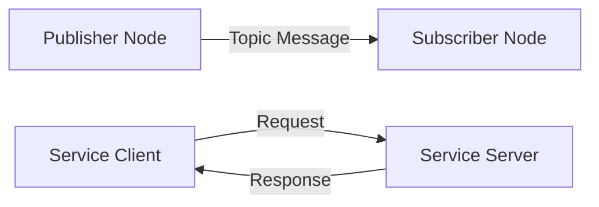

<div align="center">

# Robotics Journey

### Learning, Building and Exploring Robotics

A hands-on journey into ROS 2, robot simulation, autonomous systems and mobile robotics.

<br>


</div>

---

## About This Repository

**Robotics Journey** is my personal robotics learning and development repository, documenting my progress through practical experiments, software development and simulation-based projects.

The main objective is to build a strong foundation in robotics by understanding how different components of a robotic system work together.

This repository focuses on hands-on learning rather than theory alone, with practical implementations using **ROS 2, Python, URDF and Gazebo**.

## Table of Contents

- [Repository Overview](#repository-overview)
- [ROS 2 Basics](#1-ros-2-basics)
- [UGV Project](#2-ugv-project)
- [Technology Stack](#technology-stack)
- [Getting Started](#getting-started)
- [Learning Roadmap](#learning-roadmap)
- [Future Goals](#future-goals)
- [Author](#author)

---

## Repository Overview

| Project | Description | Status |
|---|---|---|
| [ROS 2 Basics](./ros2-basics/) | Learning ROS 2 communication concepts and Python nodes. | Completed |
| [UGV Project](./ugv-project/) | Developing and simulating a four-wheeled Unmanned Ground Vehicle. | In Progress |

---

## 1. ROS 2 Basics

This section covers the fundamental concepts of ROS 2 through Python-based implementations.

### Topics Covered

- Nodes and ROS 2 communication
- Publisher and Subscriber
- Service and Client
- Launch files
- Package structure
- Workspace management

### Publisher & Subscriber

A topic-based communication model where one node publishes messages and another node receives them.

<p align="center">
  
</p>

### Service & Client

A request-response communication model implemented using ROS 2 services.

<p align="center">
  
</p>

### Launch System

Running multiple ROS 2 nodes together using Python launch files.

<p align="center">
  
</p>

### Communication Overview

The following diagram illustrates the basic communication patterns explored in this section.



**Learning Notes:**

- [English Documentation](./ros2-basics/notes.en.md)
- [Türkçe Dokümantasyon](./ros2-basics/notes.tr.md)

---

## 2. UGV Project

The UGV project focuses on developing a simulated four-wheeled **Unmanned Ground Vehicle** using ROS 2 Humble and Gazebo Fortress (Ignition Gazebo 6), connected through `ros_gz`.

The project explores how robot descriptions, coordinate frames, sensor data and odometry work together in a simulated mobile robot.

### Current Features

- Four-wheeled robot model
- Parameterized robot description (URDF / xacro)
- RViz2 visualization
- Gazebo Fortress simulation with a custom obstacle world
- ROS 2 ↔ Gazebo topic bridge (`ros_gz_bridge`)
- TF2 coordinate frame management
- Basic odometry implementation
- LiDAR sensor integration (`gpu_lidar`)
- LiDAR-based obstacle avoidance node
- SLAM with `slam_toolbox` (online async mapping)

### UGV Simulation

<p align="center">
  
</p>

<p align="center">
  <i>Four-wheeled UGV simulation in Gazebo.</i>
</p>

### Robot Model & Sensors

| Component | Purpose |
|---|---|
| URDF / xacro | Defines the robot's physical structure and joints; dimensions are xacro properties. |
| TF2 | Manages coordinate frames and transformations. |
| Odometry | Estimates the robot's movement. |
| LiDAR | Provides distance measurements of the surroundings. |
| Gazebo Fortress | Provides the physics simulation, diff-drive and LiDAR sensor. |
| ros_gz_bridge | Bridges `/cmd_vel`, `/odom`, `/tf`, `/scan`, `/joint_states` and `/clock` between ROS 2 and Gazebo. |
| RViz2 | Visualizes the robot model and sensor data. |
| slam_toolbox | Builds a 2D occupancy grid map from LiDAR scans and odometry. |

### Package Structure

```
ugv-project/src/
├── ugv_description/   # Robot model (xacro) + RViz display launch
├── ugv_gazebo/        # Gazebo Fortress worlds + simulation launch (spawn, bridge)
├── ugv_bringup/       # Top-level launch files: sim, slam
├── ugv_slam/          # slam_toolbox parameters + saved maps
├── ugv_control/       # LiDAR obstacle avoidance node
└── ugv_odometry/      # Hand-written odometry node (M2 exercise)
```

### TF2 & Coordinate Frames

TF2 is used to manage the relationships between the robot's coordinate frames and understand how different parts of the robot are positioned relative to each other.

<p align="center">
  
</p>

### Odometry

A basic odometry node estimates the robot's movement using velocity information.

<p align="center">
  
</p>

### LiDAR Integration

LiDAR integration is part of the ongoing work toward environmental perception and mobile robot navigation.

<p align="center">
  
</p>

### SLAM & Mapping

The robot builds a map of the walled `ugv_world` with `slam_toolbox` while it is driven around with the keyboard. The finished map is saved with `nav2_map_server` and will be used by Nav2 in the next module.

**Learning Notes:**

- [English Documentation](./ugv-project/notes.en.md)
- [Türkçe Dokümantasyon](./ugv-project/notes.tr.md)

---

## Technology Stack

| Technology | Usage |
|---|---|
| ROS 2 Humble | Robot communication and software architecture |
| Python | ROS 2 node development |
| URDF | Robot modeling |
| Gazebo Fortress | Robot simulation |
| ros_gz | ROS 2 ↔ Gazebo integration |
| RViz2 | Robot visualization |
| TF2 | Coordinate transformations |
| Ubuntu 22.04 | Development environment |

---

## Getting Started

### Requirements

- Ubuntu 22.04
- ROS 2 Humble
- Python 3
- Gazebo Fortress + ros_gz
- RViz2

Install the simulation dependencies:

```bash
sudo apt install ros-humble-ros-gz ros-humble-xacro ros-humble-robot-state-publisher \
  ros-humble-joint-state-publisher-gui ros-humble-teleop-twist-keyboard \
  ros-humble-slam-toolbox ros-humble-nav2-map-server
```

`ros-humble-ros-gz` installs Gazebo Fortress, which is the officially paired Gazebo version for ROS 2 Humble.

### Clone the Repository

```bash
git clone https://github.com/kadirakcn00/robotics-journey.git

cd robotics-journey
```

### Build ROS 2 Basics

```bash
source /opt/ros/humble/setup.bash

cd ros2-basics

colcon build

source install/setup.bash
```

Run the publisher:

```bash
ros2 run py_pubsub my_talker
```

Open another terminal and run the subscriber:

```bash
source /opt/ros/humble/setup.bash

cd robotics-journey/ros2-basics

source install/setup.bash

ros2 run py_pubsub my_listener
```

### Build the UGV Project

```bash
source /opt/ros/humble/setup.bash

cd ugv-project

colcon build

source install/setup.bash
```

### Run the UGV in Gazebo Fortress

Start Gazebo, spawn the robot, bridge the topics and open RViz2 with a single command:

```bash
ros2 launch ugv_bringup sim.launch.py
```

Without RViz2:

```bash
ros2 launch ugv_bringup sim.launch.py rviz:=false
```

Only the robot model in RViz2 (no physics, joint sliders):

```bash
ros2 launch ugv_description display.launch.py
```

Drive the robot with the keyboard (in a new terminal):

```bash
ros2 run teleop_twist_keyboard teleop_twist_keyboard
```

Or let the LiDAR obstacle avoidance node drive it:

```bash
ros2 run ugv_control avoid_node
```

> **Note:** In Gazebo the diff-drive system already publishes `/odom` and the `odom → base_link` TF. The hand-written `ugv_odometry/odom_node` is a learning exercise from M2; do not run it together with the simulation, otherwise two nodes publish the same TF.

### Build a Map with SLAM

Start the simulation together with `slam_toolbox`:

```bash
ros2 launch ugv_bringup slam.launch.py
```

Drive the robot around the walls with `teleop_twist_keyboard` until the map in RViz2 is complete, then save it:

```bash
cd ~/robotics-journey/ugv-project/src/ugv_slam/maps
ros2 run nav2_map_server map_saver_cli -f ugv_world
```

This writes `ugv_world.pgm` and `ugv_world.yaml`. Rebuild (`colcon build`) so the map is installed with the package.

For more details, refer to the UGV project documentation.

---

## Learning Roadmap

This repository is continuously evolving as I explore more advanced robotics concepts.

| Module | Topic | Status |
|---|---|---|
| M1 | Robot Modeling (URDF) | Completed |
| M2 | TF2 & Odometry | Completed |
| M3 | Gazebo Simulation, LiDAR, SLAM & Mapping | In Progress |
| M4 | Navigation2 (Nav2) | Planned |
| M5 | Camera & Object Detection | Planned |
| M6 | TEKNOFEST 2026 UGV Course Simulation | Planned |

---

## Future Goals

- Improve the UGV robot model and simulation environment.
- Develop a deeper understanding of mobile robot localization.
- Explore SLAM and autonomous navigation.
- Simulate the TEKNOFEST 2026 Unmanned Ground Vehicle competition course in Gazebo.
- Integrate camera-based perception.
- Experiment with autonomous mobile robotics.

---

## Documentation

Each project includes English and Turkish learning notes containing explanations, commands and practical examples.

The documentation is updated alongside the development process to keep track of concepts learned and implementations completed.

---

## Author

**Abdulkadir Akcan**

Computer Engineering Student | Robotics & Autonomous Systems

- GitHub: [@kadirakcn00](https://github.com/kadirakcn00)
- LinkedIn: [kadirakcn00](https://www.linkedin.com/in/kadirakcn00/)

<div align="center">

---

**Learning by building. Improving by experimenting.**

</div>
