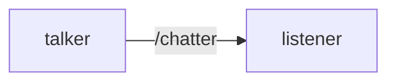
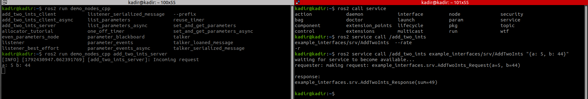
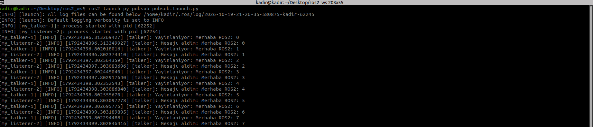

# ROS2 Basics ; 

**Version;** Foxy
**Workspace;** ~/Desktop/ros2_ws

## 1.Node 
**Definition:** Nodes are pieces of tasks that are independent of each other. For example, the node that receives the lidar data on our robot. Because nodes are independent, they do not break and they keep running. Even if the lidar node on our robot gives an error, our robot keeps running because the other nodes we can get data from are still running. 

**Commands:** 
```bash
ros2 run <paket> <node>
ros2 node list
ros2 node info /<node>
```

**Visual:**
Talker and listener are examples of nodes. While the talker publishes data, the listener passes that data on to the terminal. When we run them in separate terminals ;

```bash
ros2 run demo_nodes_cpp talker
```

```bash
ros2 run demo_nodes_cpp listener
```





## 2.Topic 
**Definition:** We can think of them as the paths that connect nodes. It provides the communication between them. 

E.g.: In the talker and listener example, /chatter is the topic. 

**Commands:**
```bash
ros2 topic list 
ros2 topic info /chatter 
ros2 topic echo /chatter
ros2 interface show std_msg/msg/String 
```
ros2 topic list: As its name suggests, it lists the topics. 

ros2 topic info /chatter : It lists how many subscribers and publishers go through this topic.
 
ros2 topic echo /chatter : It is the echo command. It works like an echo chamber, and here we can see the published content.

ros2 interface show std_msgs/msg/String : This command shows the message type. As the name indicates, this publisher publishes String. 

**Visual:**


## 3.Service and Client 
**Service:** It provides us with one-time data. We use it when we need only fixed data, not 1 million values flowing in real time. For example, temperature data or pressure data on a fixed ground. 

**Client:** The client lets us give commands to the service. Customer ---> Application relationship. Like my assigning the values a and b in an addition operation.

**Commands:** 
```bash
ros2 service list
ros2 service type /add_two_ints
ros2 interface show example_interfaces/srv/AddTwoInts
```

The image below is the code of a sample addition service and the client that gives the command

**Visual:**



## 4.Launch File

**Launch:** We can add multiple executables (triggers) to a launch file and run them. For example, the listener and talker files run at the same time in the same terminal. 

In the image below, the listener and talker write to the terminal at the same time. 


