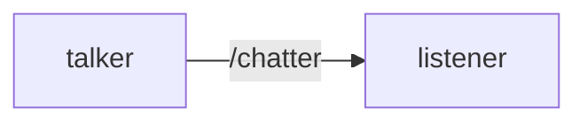

# ROS2 Basics ; 

**Version;** Foxy
**Workspace;** ~/Desktop/ros2_ws

## 1.Node 
**Tanım:** Nodelar birbirinden bağımsız görev parçalarıdır. Mesela robotumuzdaki lidar verisini alan node. Nodelar bağımsız oldukları için bozulmazlar ve çalışmaya devam ederler. Robotumuzdaki lidar node'u hata verse bile diğer veri alabileceğimiz node'lar çalıştığı için robotumuz çalışmaya devam eder. 

**Komutlar:** 
```bash
ros2 run <paket> <node>
ros2 node list
ros2 node info /<node>
```

**Görsel:**
Talker ve listener birer node örneğidir. Talker veri yayınlarken , listener o veriyi terminale aktarır. Ayrı ayrı terminalde çalıştırdığımızda ;

```bash
ros2 run demo_nodes_cpp talker
```

```bash
ros2 run demo_nodes_cpp listener
```





##2.Topic 
**Tanım:** Node'ları bağlayan yollar olarak düşünebiliriz. Aradaki haberleşmeyi sağlar. 
Ör: Talker ve listener örneğinde /chatter topictir. 

**Komutlar:**
```bash
ros2 topic list 
ros2 topic info /chatter 
ros2 topic echo /chatter
ros2 interface show std_msg/msg/String 
```
ros2 topic list: Adında geçtiği üzere topicleri listeler. 
ros2 topic info /chatter : Bu topic üzerinde kaç tane subscriber ve publisher geçtiğini listeler. 
ros2 topic echo /chatter : Echo komutudur. Yankı odası gibi çalışır ve yayınlanan içeriği burda görebiliriz.
ros2 interface show std_msgs/msg/String : Bu komut mesaj türünü gösterir. Adı geçtiği üzere bu publisher String yayınlar. 

**Görsel:**


