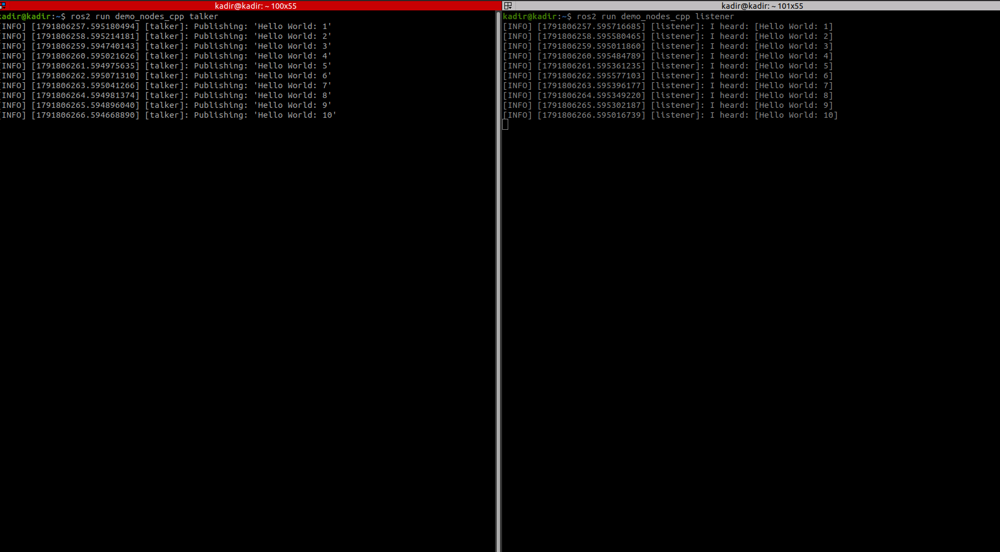

ROS2 Basics ; 

**Version;** Foxy
**Workspace;** ~/Desktop/ros2_ws

## 1.Node 
**Tanım:** Nodelar birbirinden bağımsız görev parçalarıdır. Mesela robotumuzdaki lidar verisini alan node. Nodelar bağımsız oldukları için bozulmazlar ve çalışmaya devam ederler. Robotumuzdaki lidar node'u hata verse bile diğer veri alabileceğimiz node'lar çalıştığı için robotumuz çalışmaya devam eder. 

**Komutlar:** 
```bash
ros2 run <paket> <node>
ros2 node list
ros2 node info /<node>
```

**Görsel:**
Talker ve listener birer node örneğidir. Talker veri yayınlarken , listener o veriyi terminale aktarır. Ayrı ayrı terminalde çalıştırdığımızda ;

```bash
ros2 run demo_nodes_cpp talker
```

```bash
ros2 run demo_nodes_cpp listener
```




