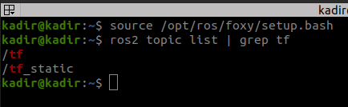
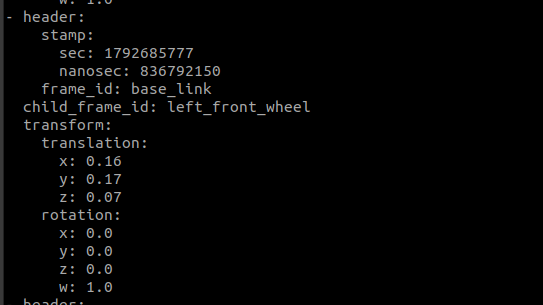
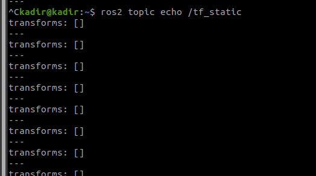
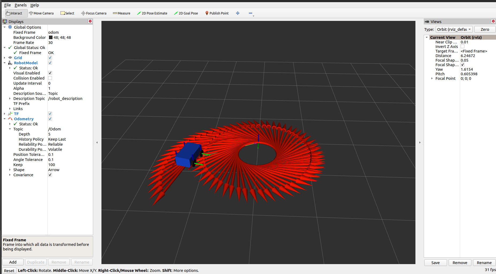
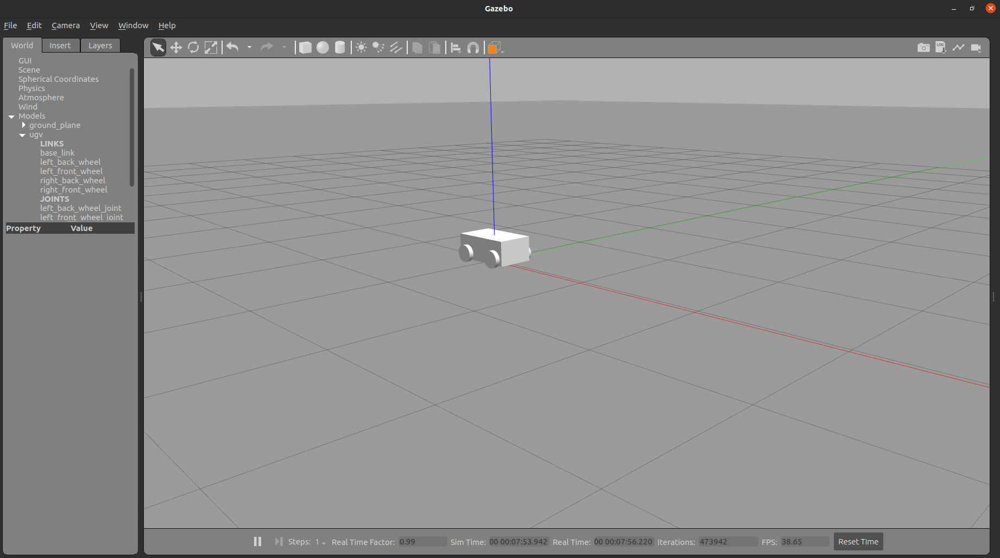
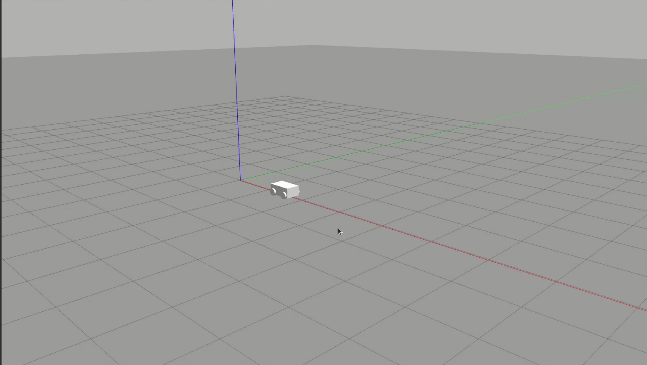

## Table of Contents
- [M1: URDF (Robot Model)](#m1-urdf-robot-model)
  - [1. URDF](#1-urdf)
  - [2. Link](#2-link)
  - [3. Visual, Geometry, Material](#3-visual-geometry-material)
  - [4. Collision](#4-collision)
  - [5. Joint](#5-joint)
  - [6. Origin and Axis](#6-origin-and-axis)
  - [7. Robot State Publisher](#7-robot-state-publisher)
  - [8. Joint State Publisher GUI](#8-joint-state-publisher-gui)
  - [9. RViz2](#9-rviz2)
  - [10. Topics and TF](#10-topics-and-tf)
  - [11. Wheel Positions](#11-wheel-positions)
  - [12. Starting the Project Again](#12-starting-the-project-again)
  - [12. Re-running the Project](#12-re-running-the-project)
- [M2: TF2 and Odometry](#m2-tf2-and-odometry)
  - [1. base_link, odom, map](#1-base_link-odom-map)
  - [2. Checking TF Info on the Robot Model](#2-checking-tf-info-on-the-robot-model)
  - [3. Our First Odometry Node: Reading cmd_vel](#3-our-first-odometry-node-reading-cmd_vel)
  - [4. Our Second Odometry Node: Position Estimation and Publishing TF](#4-our-second-odometry-node-position-estimation-and-publishing-tf)
  - [5. Terminal Commands](#5-terminal-commands)
  - [6. Odometry and Nav2](#6-odometry-and-nav2)
- [M3: Gazebo Simulation, SLAM, and Mapping](#m3-gazebo-simulation-slam-and-mapping)
  - [Inertial](#inertial)
  - [Running Our URDF File in Gazebo](#running-our-urdf-file-in-gazebo)
  - [Moving Our Robot in Gazebo and Gazebo Tag](#moving-our-robot-in-gazebo-and-gazebo-tag)

---


# M1: URDF (Robot Model)

**Environment:** Ubuntu 20.04 + ROS 2 Foxy  
**Project:** Four-wheeled ground robot (UGV)  
**File:** `~/Desktop/ros2_ws/src/ugv_project/ugv_description/urdf/ugv.urdf`

## 1. URDF

**Definition:** URDF is a format used to describe a robot's physical structure with XML. We use it to define the robot's parts, shapes, how the parts are connected, and which parts can move. All of this is written inside the `<robot>` tag.

```xml
<?xml version="1.0"?>
<robot name="ugv">

    <!-- Robot parts (links) go here -->

    <!-- Connections (joints) go here -->

</robot>
```

**Commands:**
```bash
cd ~/Desktop/ros2_ws/src/ugv_project/ugv_description/urdf
ls -l ugv.urdf
check_urdf ugv.urdf
```

- `ls -l ugv.urdf`: Checks that the file is there.
- `check_urdf ugv.urdf`: Checks whether the file can be read correctly. If it works, it prints `Successfully Parsed XML`.

**Real-life example:** Before a vehicle is put together in a factory, people plan which part goes where. URDF is like that plan for a robot.

**Note:** Passing `check_urdf` does not mean the design itself is correct. It only means the file can be read.

---

## 2. Link

**Definition:** A link is one part of a robot. Our robot has five links:

| Link | What it represents |
|---|---|
| `base_link` | Main body |
| `right_front_wheel` | Right front wheel |
| `right_back_wheel` | Right rear wheel |
| `left_front_wheel` | Left front wheel |
| `left_back_wheel` | Left rear wheel |

```xml
<link name="base_link">
</link>
```

An empty link is invisible. To give it a shape, we need to add `visual`.

**Commands:**
```bash
check_urdf ugv.urdf
grep -n '<link' ugv.urdf
```

`grep -n '<link' ugv.urdf` lists the link definitions in the file and shows their line numbers.

**Real-life example:** A toy car has a body and four wheels. In URDF, each of these is a separate link.

---

## 3. Visual, Geometry, Material

**Definition:** These tell RViz2 what the robot should look like.

- `visual`: How the part looks
- `geometry`: Its shape and size
- `material`: Its color

The chassis is a box, and the wheels are cylinders.

```xml
<visual>
    <geometry>
        <box size="0.5 0.3 0.2"/>
    </geometry>
</visual>
```

The values are in meters. In order, they mean length `0.5`, width `0.3`, and height `0.2`.

```xml
<visual>
    <geometry>
        <cylinder radius="0.07" length="0.04"/>
    </geometry>
</visual>
```

For the wheel, the radius is `0.07` and the thickness is `0.04`.

A cylinder stands upright by default. We change its direction to lay the wheel on its side:

```xml
<origin xyz="0 0 0" rpy="1.5708 0 0"/>
```

`1.5708` radians is about 90 degrees.

**Commands:**
```bash
grep -n -E 'visual|geometry|box|cylinder|material' ugv.urdf
```

This command shows the lines that contain the visual definitions.

**Real-life example:** This is like drawing the chassis as a rectangular box and the wheels as cylinders in a CAD program. For now, we use simple shapes. We can add more details with CAD later.

**Note:** If a wheel looks red in RViz2, that does not automatically mean there is an error. It may depend on the color settings.

---

## 4. Collision

**Definition:** `collision` defines the shape used when checking whether objects hit each other. It does not have to look exactly like the visible shape.

| Part | What it does |
|---|---|
| `visual` | Defines how the robot looks |
| `collision` | Defines how collisions are checked |

```xml
<collision>
    <geometry>
        <box size="0.5 0.3 0.2"/>
    </geometry>
</collision>
```

**Commands:**
```bash
grep -n -A8 '<collision>' ugv.urdf
```

This command shows the `collision` line and the eight lines below it.

**Real-life example:** A robot may have screw heads and small bumps on its body. Checking every tiny detail can make a simulation slower, so we may use one simple box to represent the body.

**Note:** Having `collision` does not mean we are ready for Gazebo yet. For physics, we also need mass (`inertial`) and a control system.

---

## 5. Joint

**Definition:** A joint is a connection between two links.

| Type | Meaning |
|---|---|
| `fixed` | Does not move |
| `revolute` | Turns within a limited angle range |
| `continuous` | Can turn all the way around |
| `prismatic` | Slides along one axis |

Our wheels use `continuous` joints.

```xml
<joint name="right_front_wheel_joint" type="continuous">
    <parent link="base_link"/>
    <child link="right_front_wheel"/>
    <origin xyz="0.16 -0.17 0.07" rpy="0 0 0"/>
    <axis xyz="0 1 0"/>
</joint>
```

- `name`: The joint's name
- `type`: How it can move
- `parent`: The main link it is attached to
- `child`: The link connected to it
- `origin`: Its position and direction
- `axis`: The axis it turns around

**Commands:**
```bash
grep -n -E '<joint|<parent|<child|<origin|<axis' ugv.urdf
```

This lists the lines related to joints.

**Real-life example:** A car wheel is attached to the body, but it can still turn around its own axis. A joint describes this connection.

---

## 6. Origin and Axis

**Definition:** `origin` tells us where a part is placed. `axis` tells us which axis a joint turns around.

```xml
<origin xyz="0.16 -0.17 0.07" rpy="0 0 0"/>
```

- `xyz`: Position (`x`, `y`, `z`), in meters
- `rpy`: Rotation (`roll`, `pitch`, `yaw`), in radians

```xml
<axis xyz="0 1 0"/>
```

This means the joint turns around the Y axis.

**Commands:**
```bash
grep -n -A5 '<joint' ugv.urdf
```

This command shows each joint and the five lines below it.

**Real-life example:** `origin` tells us how far the right front wheel is from the front, side, and bottom of the chassis. `axis` tells us which way the wheel turns.

**Origin sets the position and direction; axis sets the turning axis.**

---

## 7. Robot State Publisher

**Definition:** It uses the connection structure in the URDF to work out the position and direction of each link, then sends these updates through TF. When joint positions change, it updates the transformations too.

**Commands:**
```bash
ros2 run robot_state_publisher robot_state_publisher --ros-args -p robot_description:="$(cat ugv.urdf)"
ros2 topic list
```

Run the first command in the folder where the URDF file is saved.

`ros2 topic list` shows the available topics.

**Real-life example:** On a real robot, wheel encoders measure how the wheels turn. These values can be used to work out the wheels' positions relative to the body. Robot State Publisher shares this information with other nodes.

**Note:** It does not run the motors. It only publishes the robot's structure and coordinate transformations.

---

## 8. Joint State Publisher GUI

**Definition:** This is a small window that lets us manually change joint values. We used it to test the wheels.

**Commands:**
```bash
ros2 run joint_state_publisher_gui joint_state_publisher_gui
ros2 topic echo /joint_states
```

The first command opens a window with sliders.

`ros2 topic echo /joint_states` shows the joint values in the terminal as we move the sliders.

**Real-life example:** We have not built the physical robot yet. We can use this window to change the wheel angles and check that the connections work, even without motors.

**Result:** When we move the sliders, the wheels turn in RViz2.

**Note:** This does not mean the robot moves across the ground. We are only seeing the joints move.

---

## 9. RViz2

**Definition:** RViz2 is a tool for showing the robot model and other robot-related information.

- `RobotModel`: The display that shows the robot from the URDF
- `Fixed Frame`: The coordinate frame used as the main reference for the view. We use `base_link`.

**Commands:**
```bash
rviz2
```

After it opens:

1. Click `Add`.
2. Add `RobotModel`.
3. Under `Global Options`, set `Fixed Frame` to `base_link`.
4. Check that the robot is visible.

We can also add the `TF` display to see the coordinate frames.

**Real-life example:** If we attach a camera to the robot's body, we can use RViz2 to see where the camera is compared with the body.

**Note:** RViz2 is not a physics simulator. It does not calculate gravity or friction.

---

## 10. Topics and TF

**Definition:** These are the topics we saw during this work:

| Topic | What it does |
|---|---|
| `/joint_states` | Gives joint position, speed, and effort information |
| `/robot_description` | Contains the robot's URDF description |
| `/tf` | Shares coordinate transformations that can change |
| `/tf_static` | Shares coordinate transformations that stay fixed |

**TF:** A system that keeps track of how the coordinate frames of the robot's parts relate to each other.

**Commands:**
```bash
ros2 topic list
ros2 topic echo /joint_states
ros2 topic info /joint_states
```

**Real-life example:** Imagine we put a camera on the front of the robot and an IMU on its body. If we know where the sensors are compared with the body, we can understand their data more correctly. TF keeps track of these positions and directions.

---

## 11. Wheel Positions

**Definition:** Each of the four wheels has its own link and joint. Their positions are measured relative to `base_link`.

| Wheel | Joint | `origin xyz` |
|---|---|---|
| Right front | `right_front_wheel_joint` | `0.16 -0.17 0.07` |
| Right rear | `right_back_wheel_joint` | `-0.16 -0.17 0.07` |
| Left front | `left_front_wheel_joint` | `0.16 0.17 0.07` |
| Left rear | `left_back_wheel_joint` | `-0.16 0.17 0.07` |

**Commands:**
```bash
grep -n -A5 '<joint' ugv.urdf
```

**Real-life example:** A car has two wheels at the front and two at the back. Here, we describe the same layout using numbers. If we change the values, the wheel positions change.

For now, the chassis is a simple box and does not have wheel wells. We will work on those later with CAD.

---

## 12. Starting the Project Again

**Definition:** We need three programs, and each one runs in a separate terminal. If you close one, that program stops.

1. `robot_state_publisher`: Publishes the transformations
2. `joint_state_publisher_gui`: Lets us change the joint angles
3. `rviz2`: Shows the robot

**Commands:**

First, open the URDF folder and check the file:

```bash
cd ~/Desktop/ros2_ws/src/ugv_project/ugv_description/urdf
check_urdf ugv.urdf
```

**Terminal 1:**
```bash
ros2 run robot_state_publisher robot_state_publisher --ros-args -p robot_description:="$(cat ugv.urdf)"
```

**Terminal 2:**
```bash
ros2 run joint_state_publisher_gui joint_state_publisher_gui
```

**Terminal 3:**
```bash
rviz2
```

Remember to run this in each new terminal first:

```bash
source /opt/ros/foxy/setup.bash
```

**Real-life example:** When testing robot software, the program that describes the robot, the program that sends joint values, and the program that displays the model each have a different job. Starting each one correctly helps us repeat the test.

---

## 12. Re-running the Project
**Definition:** Three parts are needed and each one runs in a separate terminal. If you close one, that part stops.

1. `robot_state_publisher`: Publishes transformations
2. `joint_state_publisher_gui`: Changes joint angles
3. `rviz2`: Shows

**Commands:**
```bash
cd ~/Desktop/ros2_ws/src/ugv_project/ugv_description/urdf
check_urdf ugv.urdf
```

Terminal 1:
```bash
ros2 run robot_state_publisher robot_state_publisher --ros-args -p robot_description:="$(cat ugv.urdf)"
```

Terminal 2:
```bash
ros2 run joint_state_publisher_gui joint_state_publisher_gui
```

Terminal 3:
```bash
rviz2
```

Do not forget to do `source /opt/ros/foxy/setup.bash` in each new terminal first.

---

# M2: TF2 and Odometry

**Concept of Coordinate Frame**

A coordinate frame has three main axes:
- X: Forward-backward
- Y: Right-Left
- Z: Up-down

**Example:** When the robot moves right-left or forward-backward, its coordinate frame changes.

## 1. base_link, odom, map

**base_link**
The coordinate frame attached to the robot's link/chassis. When the robot moves forward, base_link moves along with it.

**odom**
The coordinate frame used to track the robot's motion. Odometry is used to estimate changes in the robot's position and movements.

**map (Map Reference)**
The coordinate frame that shows the robot's movement on the map. A SLAM or another localization system helps estimate the robot's position on the map.

| Coordinate Frame | What does it explain? | Simple Example |
|---|---|---|
| `base_link` | Robot's own local position and directions | Where is the camera relative to the chassis? |
| `odom` | Position tracked throughout the motion | How far have we moved since the start? |
| `map` | Position relative to the map | Where are we on the map? |

The relationship between the three is as follows:
map → odom → base_link

## 2. Checking TF Info on the Robot Model

First, we get the topic info:

```bash 
ros2 topic list | grep tf 
```



---

Then, we check the TF messages:

```bash 
ros2 topic echo /tf 
```



**What information do these parts give us?**

**1. frame_id: base_link**
It states that the reference coordinate frame is on the robot's chassis. So we take our reference point relative to base_link.

**2. child_frame_id: right_front_wheel**
It shows that the right front wheel is the target frame. So the coordinate frame of the right front wheel is linked to base_link.

**3. translation: Where is the wheel?**
```yaml
translation:
  x: 0.16
  y: -0.17
  z: 0.07
```
Shows the position of the wheel.

**4. rotation: Which way is the wheel facing?**
```yaml
rotation:
  x: 0.0
  y: 0.0
  z: 0.0
  w: 1.0
```
No extra movement is visible because our vehicle is standing still.

**5. stamp: When was this transform published?**
```yaml
stamp:
  sec: 1792685855
  nanosec: 236565646
```
This field carries the time info of the transform.
- sec: The seconds part
- nanosec: Extra time in billionths of a second

Time info is especially important for moving robots. Because it is best to evaluate sensor data and the robot's position relative to the exact same moment.

---
We can also view /tf_static messages using the echo method.

```bash 
ros2 topic echo /tf_static
```



## 3. Our First Odometry Node: Reading `cmd_vel`

Our first Python code listens to the `cmd_vel` topic and prints the incoming velocity commands on the screen.

### Code

```python
import rclpy
from rclpy.node import Node
from geometry_msgs.msg import Twist


class OdomNode(Node):
    def __init__(self):
        super().__init__('odom_node')

        self.sub = self.create_subscription(
            Twist,
            'cmd_vel',
            self.cmd_callback,
            10
        )

    def cmd_callback(self, msg):
        self.get_logger().info(
            f'v = {msg.linear.x}, w = {msg.angular.z}'
        )


def main(args=None):
    rclpy.init(args=args)
    node = OdomNode()

    rclpy.spin(node)

    node.destroy_node()
    rclpy.shutdown()


if __name__ == '__main__':
    main()
```

### 3.1. Libraries used

**`rclpy`**
Allows us to develop ROS 2 nodes with Python.

**`Node`**
The base class of our ROS 2 node.

**`Twist`**
The message type used to carry linear and angular velocity commands.

### 3.2. Creating the node

```python
super().__init__('odom_node')
```
Sets the name of the ROS 2 node as `odom_node`.

### 3.3. Creating the subscription

```python
self.sub = self.create_subscription(
    Twist,
    'cmd_vel',
    self.cmd_callback,
    10
)
```
This line subscribes to the `cmd_vel` topic.

Meaning of the parameters:
- `Twist`: Expected message type.
- `cmd_vel`: Topic to listen to.
- `self.cmd_callback`: Function to run when a message arrives.
- `10`: Message queue depth of the subscription.

### 3.4. Reading velocity values

```python
def cmd_callback(self, msg):
    self.get_logger().info(
        f'v = {msg.linear.x}, w = {msg.angular.z}'
    )
```
Here:
- `msg.linear.x`: Linear velocity along the X-axis.
- `msg.angular.z`: Angular velocity around the Z-axis.

In ROS, these values are used by default with units of meters/second for linear velocity and radians/second for angular velocity.

This first code does not calculate position using velocities. It only prints the incoming values on the screen.

---

## 4. Our Second Odometry Node: Position Estimation and Publishing TF

Our second code, unlike the first one, processes the velocity commands over time.

The goal of this code is:
1. Getting velocity commands via `cmd_vel`.
2. Accepting the starting position as zero.
3. Calculating the approximate position based on velocity and elapsed time.
4. Publishing the `odom → base_link` transform over TF.

This approach is a simplified model prepared to learn the core logic of odometry.

### 4.1. Libraries used

```python
import math
import rclpy
from rclpy.node import Node
from geometry_msgs.msg import Twist, TransformStamped
from tf2_ros import TransformBroadcaster
```
- `math`: Used for trigonometric calculations.
- `rclpy`: ROS 2 Python interface.
- `Node`: ROS 2 node class.
- `Twist`: Carries velocity commands.
- `TransformStamped`: Carries timestamp and coordinate transform details.
- `TransformBroadcaster`: Publishes dynamic TF transforms.

### 4.2. Initial variables

```python
self.x = 0.0
self.y = 0.0
self.theta = 0.0

self.v = 0.0
self.w = 0.0

self.last_time = self.get_clock().now()
```

Duties of variables:

| Variable | Meaning |
| ----------- | -------------------------------------- |
| `x` | Estimated X position |
| `y` | Estimated Y position |
| `theta` | Estimated orientation angle |
| `v` | Last received linear velocity |
| `w` | Last received angular velocity |
| `last_time` | Timestamp of the previous update |

At the start, the robot's position and orientation are assumed to be zero.

### 4.3. Creating the TF broadcaster

```python
self.tf_broadcaster = TransformBroadcaster(self)
```
This object allows the node to publish TF transforms.

### 4.4. Creating the timer

```python
self.timer = self.create_timer(0.05, self.update)
```
The `update()` function is called approximately every 0.05 seconds.

Calculation:
`1 / 0.05 = 20 Hz`

So under normal conditions, the node tries to update its position about 20 times a second.

### 4.5. Storing incoming velocities

```python
def cmd_callback(self, msg):
    self.v = msg.linear.x
    self.w = msg.angular.z
```
This function updates linear and angular velocities whenever a new velocity command arrives.

There is an important detail here: The code does not automatically reset velocities to zero when no new message comes. Last received values keep being used until they change.

### 4.6. Calculating elapsed time

```python
now = self.get_clock().now()

dt = (now - self.last_time).nanoseconds / 1e9

self.last_time = now
```
`dt` calculates the duration between two updates in seconds.

To convert nanoseconds to seconds, `1e9` (one billion) is used.

For example, if 0.05 seconds passed between two updates, `dt` becomes roughly `0.05`.

Since real timing can lag, it is not guaranteed for this value to be exactly 0.05 every single time.

### 4.7. Updating the position

```python
self.x += self.v * math.cos(self.theta) * dt
self.y += self.v * math.sin(self.theta) * dt
self.theta += self.w * dt
```
This section is the part of the code that handles motion calculation.

Simplified differential motion model used:
- Velocity along X direction: `v * cos(theta)`
- Velocity along Y direction: `v * sin(theta)`
- Orientation change rate: `w`

These velocities are multiplied by the elapsed time to convert them into an approximate position change.

#### Example: Straight forward movement

At the start:
```text
x = 0
y = 0
theta = 0
v = 0.2 m/s
w = 0 rad/s
```
Since orientation is zero:
`cos(0) = 1`
`sin(0) = 0`

In an update of about 0.05 seconds:
`Δx = 0.2 × 1 × 0.05 = 0.01 m`
`Δy = 0.2 × 0 × 0.05 = 0 m`

The robot's estimated position moves forward by about 1 cm along X.
As this process repeats, the X position increases.

#### Example: Turning while moving

When linear velocity is `0.2 m/s` and angular velocity is `0.5 rad/s`, the robot both moves forward and its orientation angle changes.
The code updates the orientation angle at every loop. This new angle is used in subsequent position calculations.

This method is enough for learning purposes; but because it performs step-by-step numerical integration, the calculated position is an approximate value.

### 4.8. Preparing the transform message

```python
t = TransformStamped()

t.header.stamp = now.to_msg()
t.header.frame_id = 'odom'
t.child_frame_id = 'base_link'
```
This part creates the `odom → base_link` transform message.
- `header.stamp`: Timestamp of the transform.
- `header.frame_id`: Reference frame, `odom`.
- `child_frame_id`: The frame whose position is being expressed, `base_link`.

Therefore, the message represents the estimated position of the robot chassis relative to the odometry reference.

### 4.9. Transferring position values to the message

```python
t.transform.translation.x = self.x
t.transform.translation.y = self.y
t.transform.translation.z = 0.0
```
Calculated X and Y positions are transferred to the message.
Since the Z value is kept at zero, it is assumed that the robot does not move vertically.

### 4.10. Calculating orientation values

```python
t.transform.rotation.x = 0.0
t.transform.rotation.y = 0.0

t.transform.rotation.z = math.sin(self.theta / 2.0)
t.transform.rotation.w = math.cos(self.theta / 2.0)
```
TF expresses orientation in quaternion format.
Assuming there is rotation only around the Z-axis, the orientation angle `theta` is converted into a quaternion like this:
- `z = sin(theta / 2)`
- `w = cos(theta / 2)`
X and Y components are zero.

### 4.11. Publishing the transform

```python
self.tf_broadcaster.sendTransform(t)
```
Ensures the prepared transform is published over the TF system.
This way, TF tools can query the `base_link` position relative to the `odom` reference.

---

## 5. Terminal Commands

### 5.1. Sending a linear velocity command

```bash
ros2 topic pub --once /cmd_vel geometry_msgs/msg/Twist "{linear: {x: 0.2}}"
```
This command sends a single `Twist` message to the `/cmd_vel` topic.
Linear X velocity is set to `0.2 m/s`.
However, `--once` only ensures the message is published once. It does not reset the velocity inside.
Since our Python node stores the last received velocity, it continues calculation with this velocity until a new zero velocity message arrives.

### 5.2. Resetting linear velocity

```bash
ros2 topic pub --once /cmd_vel geometry_msgs/msg/Twist "{linear: {x: 0.0}}"
```
This command sends a message that resets the linear velocity.
If you also want to reset the angular velocity, it is safer to explicitly state `angular.z: 0.0` in the message.

### 5.3. Turning while moving forward

```bash
ros2 topic pub --once /cmd_vel geometry_msgs/msg/Twist "{linear: {x: 0.2}, angular: {z: 0.5}}"
```
In this message:
- Linear X velocity: `0.2 m/s`
- Angular Z velocity: `0.5 rad/s`
is set. The node uses these values to calculate approximate position and orientation.

### 5.4. Checking the TF transform

```bash
ros2 run tf2_ros tf2_echo odom base_link
```
This command queries the transform between `odom` and `base_link`.
For this to work, the related transform must be published in the TF system. Therefore, it is important that our odometry node is running.
In the output, we can see the estimated position and orientation of the robot.

### 5.5. Sending velocity commands from the keyboard

```bash
ros2 run teleop_twist_keyboard teleop_twist_keyboard
```
This command starts the teleoperation node that sends velocity commands from the keyboard.
Commands sent from the keyboard reach the `/cmd_vel` topic. Our odometry node can take these messages and perform position estimation.
However, our current code only publishes the estimated TF transform. To physically move the robot model, a simulation or a motion control system is also required.

---

## 6. Odometry and Nav2

### Nav2
Using only the /tf topic from the odom node gives incomplete info regarding the robot's position. The /odom topic mentioned above only gives us (position+orientation) details.

The "nav_msgs/Odometry" message we will make now also shows how fast we are going.
Nav2's velocity controllers read the real speed of the robot from this topic.

I am adding the following codes into `/ugv_odometry/ugv_odometry/odom_node.py`.

**A. ADD TO THE IMPORT SECTION**
```python
from nav_msgs.msg import Odometry
```

**B. Add inside __init__ under tf_broadcaster**
```python
self.odom_pub = self.create_publisher(Odometry, 'odom', 10)
```

**C. Add to the very bottom of the update function**
```python
        odom = Odometry()
        odom.header.stamp = now.to_msg()
        odom.header.frame_id = 'odom'
        odom.child_frame_id = 'base_link'
        odom.pose.pose.position.x = self.x
        odom.pose.pose.position.y = self.y
        odom.pose.pose.orientation.z = math.sin(self.theta / 2.0)
        odom.pose.pose.orientation.w = math.cos(self.theta / 2.0)
        odom.twist.twist.linear.x = self.v
        odom.twist.twist.angular.z = self.w
        self.odom_pub.publish(odom)
```

After doing these, save the code with colcon build:
```bash
cd ~/Desktop/robotics-journey
colcon build --packages-select ugv_odometry
source install/setup.bash
ros2 run ugv_odometry odom_node
```

Let's measure the values of our topics in the terminal:
```bash
ros2 topic info /odom
ros2 topic hz /odom
ros2 topic echo /odom
```

Our topic info value should be our message type, which is "nav_msgs/msg/Odometry".
Topic hz is our publishing rate. Since our timer value is 0.05, we see around 20 Hz.
In topic echo:
```yaml
header:
  stamp:
    sec: 1793277451
    nanosec: 599714739
  frame_id: odom
child_frame_id: base_link
pose:
  pose:
    position:
      x: 0.1941129012528342
      y: 0.7524622240899774
      z: 0.0
    orientation:
      x: 0.0
      y: 0.0
      z: -0.9713467705246945
      w: -0.23766668128125656
  covariance: [0.0, ...]
twist:
  twist:
    linear:
      x: 0.2
      y: 0.0
      z: 0.0
    angular:
      x: 0.0
      y: 0.0
      z: 0.5
  covariance: [0.0, ...]
```

We see a long message like this. The important parts here are pose and twist values.

**What do Pose and Twist explain?**

| Name | What does it tell? | Car Example | Match in Output |
|---|---|---|---|
| pose | Where it is and which way it looks | Position and orientation | position.x, orientation.z |
| twist | How fast it goes and turns | Speedometer and steering turn rate | linear.x: 0.2 (m/s), angular.z: 0.5 (rad/s) |

**Using Odom in Rviz and Giving Direction with Terminal Commands**

There is an extra odometry tab we will add in Rviz, and when we set the main topic to /odom, we see trails showing which way we went.
We used rviz and robot_state_publisher in the URDF topic.

When we open rviz using these terminal codes:
Global Options Topic: `/odom`
Odometry Topic: `/odom`

When we move our robot using this command:
```bash
ros2 topic pub --once /cmd_vel geometry_msgs/msg/Twist "{linear: {x: 0.0}, angular: {z: 0.0}}"
```
It looks like this:




# M3: Gazebo Simulation, SLAM, and Mapping

## Inertial

In Rviz, we were simulating the robot independent of physics laws. Things change a bit in Gazebo. Here, it must know the mass and moments of inertia of each link.
Here, our inertial tag in the URDF file comes into play.

**mass:** Mass of the link
**inertia:** Inertia is the link's resistance to rotation. If torque is the turning effect, inertia is the counter force against it. We can think of the difference between trying to spin a rod from its center versus from its edge.

```xml
<inertial>
	<mass value="5.0"/>
	<inertia ixx="0.0542" ixy="0" ixz="0" iyy="0.1208" iyz="0" izz="0.1417"/>
</inertial>	 
```

**So what are Ixx, Ixy, Ixz, Iyy, Iyz, Izz?**
These are inertias in 3D space. Ixy, Ixz, Iyz take 0 value because we have a symmetric robot.
Other values are calculated using the formula below:

**For a Rectangular Box:**
- ixx = m/12 · (y² + z²)
- iyy = m/12 · (x² + z²)
- izz = m/12 · (x² + y²)

Chassis: m = 5 kg, x = 0.5, y = 0.3, z = 0.2:
- ixx = 5/12 · (0.09 + 0.04) = 0.0542
- iyy = 5/12 · (0.25 + 0.04) = 0.1208
- izz = 5/12 · (0.25 + 0.09) = 0.1417

**Let's Add to Our URDF File**
1. Let's add inside base_link under visual.
```xml
    <collision>
      <geometry>
        <box size="0.5 0.3 0.2"/>
      </geometry>
    </collision>
    <inertial>
      <mass value="5.0"/>
      <inertia ixx="0.0542" ixy="0" ixz="0" iyy="0.1208" iyz="0" izz="0.1417"/>
    </inertial>
```

2. Let's add inside the wheel link under visual.
```xml
    <collision>
      <origin xyz="0 0 0" rpy="1.5708 0 0"/>
      <geometry>
        <cylinder radius="0.07" length="0.04"/>
      </geometry>
    </collision>
    <inertial>
      <mass value="0.5"/>
      <inertia ixx="0.000679" ixy="0" ixz="0" iyy="0.001225" iyz="0" izz="0.000679"/>
    </inertial>
```

## Running Our URDF File in Gazebo

1. Let's open Gazebo:
```bash
source /opt/ros/foxy/setup.bash
ros2 launch gazebo_ros gazebo.launch.py
```

2. Let's add the robot:
```bash
source /opt/ros/foxy/setup.bash
ros2 run gazebo_ros spawn_entity.py -entity ugv -file ~/Desktop/ros2_ws/src/ugv_project/ugv_description/urdf/ugv.urdf -z 0.2
```
And it looks like this:




## Moving Our Robot in Gazebo and Gazebo Tag

1. For this, we need to open a `<gazebo>` tag in our URDF file.
I used separate gazebo tags for front and rear wheels.

- For Front Wheels:
```xml
  <gazebo>
	<plugin name="front_wheel" filename="libgazebo_ros_diff_drive.so">
    	<!-- Wheel Info -->
        <left_joint>left_front_wheel_joint</left_joint>
        <right_joint>right_front_wheel_joint</right_joint>
        <wheel_separation>0.064</wheel_separation>
        <wheel_diameter>0.098</wheel_diameter>
 
        <!-- Our Limit -->
        <max_wheel_torque>200</max_wheel_torque>
        <max_wheel_acceleration>10.0</max_wheel_acceleration>
 
        <!-- Output -->
        <odometry_frame>odom</odometry_frame>
        <robot_base_frame>base_link</robot_base_frame>
 
        <publish_odom>true</publish_odom>
        <publish_odom_tf>true</publish_odom_tf>
        <publish_wheel_tf>true</publish_wheel_tf>
	</plugin>
  </gazebo>
```

- For Rear Wheels:
```xml
  <gazebo>
	<plugin name="back_wheel" filename="libgazebo_ros_diff_drive.so">
    	<!-- Wheel Info -->
        <left_joint>left_back_wheel_joint</left_joint>
        <right_joint>right_back_wheel_joint</right_joint>
        <wheel_separation>0.064</wheel_separation>
        <wheel_diameter>0.098</wheel_diameter>
 
        <!-- Our Limit -->
        <max_wheel_torque>200</max_wheel_torque>
        <max_wheel_acceleration>10.0</max_wheel_acceleration>
 
        <!-- Output -->
        <odometry_frame>odom</odometry_frame>
        <robot_base_frame>base_link</robot_base_frame>
 
        <publish_odom>true</publish_odom>
        <publish_odom_tf>true</publish_odom_tf>
        <publish_wheel_tf>true</publish_wheel_tf>
	</plugin>
  </gazebo>
```

We add these right above the closing `</robot>` tag.

We open our robot project in Gazebo and type these commands in a separate terminal to run our topic:
```bash
ros2 topic pub --once /cmd_vel geometry_msgs/msg/Twist "{linear: {x: 0.2}}"
```

To stop it:
```bash
ros2 topic pub --once /cmd_vel geometry_msgs/msg/Twist "{linear: {x: 0.0}}"
```
typing the command is enough.

If we want to manage it from the keyboard, we will need to type this command:
```bash
ros2 run teleop_twist_keyboard teleop_twist_keyboard
```


